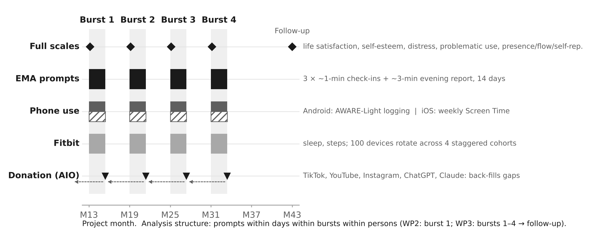

# Digital Days: fast-clock pipeline for *Years and moments*

This is the data pipeline for the WP2–WP3 measurement-burst study. About 400 young adults aged 18–25 take part in four 14-day bursts, six months apart, followed by a final follow-up survey. Five data streams are lined up on one timeline:

| Stream | Tool | Captured | Fallback |
|---|---|---|---|
| Full scales | Qualtrics/REDCap | SWLS, RSES, DASS-21, BSMAS, IGDS9-SF, presence, flow, self-representation, at burst start and follow-up | – |
| EMA | AWARE-Light ESM, or one cross-platform EMA app | 3 check-ins a day (mood, loneliness, stress, online use) + evening report (sleep, mood, life satisfaction, self-esteem, AI use and purpose, presence, flow, self-representation) | – |
| Phone use | AWARE-Light 4.2.1 (Android) | foreground apps, screen unlock sessions, notification metadata | iOS: weekly Screen Time upload |
| Wearable | Fitbit, via the **Google Health API v4** | sleep, daily steps, minutes with heart rate (wear time) | Fitabase export |
| Donation | Australian Internet Observatory (AIO), or the **direct donation portal** (`docs/donate.html`) | TikTok, YouTube, Instagram, ChatGPT, Claude data download packages (DDPs) | – |

**See it:** the pipeline explorer (`docs/index.html`) shows a participant's study day, the burst calendar, every stream, every link with its status, and the simulation check. The donation portal (`docs/donate.html`) is the participant-facing route outside the AIO. Both are static pages: turn on GitHub Pages (Settings → Pages → branch `main`, folder `/docs`) or open them from a downloaded/Zenodo copy.



## Run it

```bash
pip install -r requirements.txt
PYTHONPATH=src python -m digital_days.run --simulate      # configs + simulated raw data + full pipeline + recovery check + site data
PYTHONPATH=src python -m pytest -q tests                  # 12 end-to-end tests
PYTHONPATH=src python -m digital_days.figure              # regenerate the C1 figure
PYTHONPATH=src python -m digital_days.build_site          # rebuild docs/data/pipeline.json(.js) from config/
```

`--simulate` writes every raw stream in its native format: AWARE MySQL table exports, Google Health API v4 responses, ChatGPT/Claude `conversations.json`, TikTok and Takeout JSON, a portal-minimised Instagram file, and iOS uploads. It then runs ingest, alignment, quality control (QC) and the Mplus export, and checks that a planted within-person effect is recovered. That effect is late-night AI chatting lowering next-day mood. On the reference run (N = 60, 2 bursts, 30 Oct 2026) the recovered effect was β = −0.30 (planted −0.30, p < .001), with 59% compliance, 12.7 valid Fitbit days per burst, and no Fitbit device clashes across 400 participants. This tests the code, not the hypothesis.

## What is where

```
config/study.yaml                 design parameters (single source of truth)
config/item_bank.yaml             full scales + EMA forms, status (published/adapted/new), licence, parent item
config/demographics.yaml          baseline demographics incl. quota variables and OS routing
config/donation_instructions.yaml participant-facing DDP request steps + links (AIO uploader and portal)
config/links.yaml                 every researcher- and participant-facing link, with status
config/app_categories.csv         Android package -> category (AI chatbot, social media, ...)
src/digital_days/
  build_aware_config.py   -> build/aware/aware_light_study_config.json (import in the AWARE Configurator)
  export_forms.py         -> build/forms/ (EMA items, full scales, codebook, public item bank)
  fitbit_client.py        Google Health API v4 client + Google OAuth helpers; legacy reader; Fitabase
  ingest.py               AWARE, iOS, Google Health / legacy Fitbit, raw-DDP and portal donation parsers
  align.py                moments within days within bursts within persons; lagged within-person predictors
  qc.py                   compliance, straight-lining, wear time, passive coverage, donation receipt
  rotation.py             Fitbit device rotation scheduler
  simulate.py             native-format synthetic data with a planted effect
  run.py                  orchestration + Mplus .dat export + recovery check
  build_site.py           -> docs/data/pipeline.json(.js) for the two web pages
  figure.py               C1 figure
docs/index.html           pipeline explorer (static)
docs/donate.html          direct donation portal (static; processing happens in the participant's browser)
```

## Fitbit via the Google Health API

Google ended support for the legacy Fitbit Web API on 30 Sep 2026 and switches its endpoints off on **2 Nov 2026** ([developers.google.com/health](https://developers.google.com/health)). The client now uses Google Health API v4 (`https://health.googleapis.com/v4`), checked against the v4 discovery document:

| Need | v4 call | Saved as |
|---|---|---|
| Sleep (main sleep, dated by wake day) | `GET users/me/dataTypes/sleep/dataPoints` with `filter=sleep.interval.civil_end_time >= … AND < …` (25 per page) | `gh_sleep.json` |
| Daily steps | `POST users/me/dataTypes/steps/dataPoints:dailyRollUp` (civil days; ≤ 90 days per call) | `gh_steps_daily.json` |
| Wear time | `POST users/me/dataTypes/heart-rate/dataPoints:rollUp`, `windowSize: "60s"`, one local day per call | `gh_wear_minutes.json` |

Scopes (read-only): `googlehealth.sleep.readonly`, `googlehealth.activity_and_fitness.readonly`, `googlehealth.health_metrics_and_measurements.readonly`. Heart rate is stored at 1-second and steps at 1-minute resolution, so minute-level wear time is available. v4 has no sleep-efficiency field; it is derived as minutes asleep ÷ minutes in the sleep period.

Setup (one-off, needs an RMIT Google account with Cloud access):

1. Google Cloud console → new project (e.g., `rmit-digital-days`) → enable **Google Health API**.
2. OAuth consent screen (External; RMIT branding; privacy policy URL) → add the three scopes above. Health scopes are sensitive, so Google verification is required before more than test users can consent; add pilot accounts as test users meanwhile. Review the [Health API research pledge](https://developers.google.com/health/policies/health-api-research-pledge).
3. Create a **Web application** OAuth client; set the redirect URI to the study's consent-landing page.
4. Export `GOOGLE_HEALTH_CLIENT_ID`, `GOOGLE_HEALTH_CLIENT_SECRET`, `GOOGLE_HEALTH_REDIRECT_URI`, and `DD_TOKEN_STORE` (a secure folder outside this repository).
5. Per participant: `python -m digital_days.fitbit_client auth-url DD1A2B3C4D` → participant signs in with the Google account linked to the study Fitbit → `exchange DD1A2B3C4D <code>` → daily `pull DD1A2B3C4D <start> <end>`.

AWARE's own Fitbit plugin is not used: it calls the legacy API.

## Data donation outside the AIO

`docs/donate.html` is a prototype of a direct route. The participant enters their study code, follows the export steps for one platform (taken from `config/donation_instructions.yaml`), and selects the downloaded `.zip`/`.json`. The page parses it **in the browser**, keeps only what the study needs (own AI-chat messages with timestamps; AI replies reduced to time and length; for TikTok, YouTube and Instagram only event times), shows a per-conversation or per-day table where anything can be removed, and saves `digital_days_donation_<source>_<code>.json` (schema `digital-days-donation/1`), which `ingest.donation_portal` reads. The secure upload destination (e.g., a REDCap file field keyed to the study code) is left to configure after ethics. The AIO remains the primary route in the grant.

## Status: what is done and what still needs a person

| Item | Status |
|---|---|
| AWARE-Light study configuration (JSON in Configurator import format) | **Built and import-tested** (30 Oct 2026): configurator.awareframework.com → "Update an existing study" reads all 35 questions, both schedules and the 13 sensor settings. Still needed: RMIT ITS MySQL database (host, INSERT-only account, root credentials for "Initialize database"), then "Download study config" and generate the participant QR. Use only the Configurator's left-hand menu; a page reload clears the imported study. |
| EMA item bank (35 items; every construct tested for invariance across bursts has ≥3 items) | **Drafted.** Momentary items are *new or adapted*; cognitive pretesting in the pilot burst |
| Full-scale battery | **Mapped.** Text for SPQ, UAB, Proteus and IGDS9-SF lives in the 2021 battery; add once licences are checked |
| Problematic AI use scale | **Open decision.** No instrument chosen yet |
| Fitbit | **Google Health API v4 client written and tested offline.** Needs the RMIT Google Cloud project, OAuth client and scope verification. Legacy reader kept for pre-shutdown backfills |
| AIO donation | Project configured on the AIO, pending ethics. DDP instructions in `config/donation_instructions.yaml` |
| Direct donation portal | **Prototype.** Parsers for ChatGPT, Claude, TikTok, YouTube, Instagram run in the browser; upload destination to configure |
| iOS | Weekly Screen Time schema; screenshot transcription is manual (double entry) |
| Ethics | Not yet submitted for this design |

## Design decisions worth defending

- **Privacy-minimal sensing.** Keyboard, screen text, messages, calls, location and motion sensors are all off. Nothing needed for Aims 2–3 depends on them.
- **Study day runs 04:00–03:59.** Late-night use belongs to the evening before, so its effect is tested on the *next* day.
- **AI-chat text.** The pipeline keeps only participants' own words, which feed the WP2.2 language indicators. The AI's replies are reduced to timestamp and length. Text stays in secure RMIT storage and is never exported (`*_SECURE.csv` is gitignored).
- **Donation minimisation happens before data leave the device** (portal route), and the participant sees exactly what is shared.
- **Missing versus zero.** For people who donated, a day with no donated activity counts as zero. For people who did not donate, it is missing.
- **One EMA delivery app for everyone, if possible.** Otherwise the phone's operating system is confounded with how prompts are delivered, and the OS likely tracks socioeconomic background, one of the quota variables.

## Suggested C1 wording

> The WP2 protocol is specified as executable code (sensor configuration, prompt schedule, item bank, Google Health API and data-donation ingestion, alignment scripts), tested end to end on simulated data that recover a planted within-person effect, and openly versioned³⁹ (Fig. X).

Do **not** write "pilot pipeline tested" until the 30-person pilot burst has run.

## Archiving on Zenodo

`CITATION.cff` and `.zenodo.json` are included. Link the repository in Zenodo (GitHub integration → toggle `digital-days` on), then create a GitHub release (e.g., `v0.2.0`); Zenodo mints a DOI for that snapshot. Zenodo stores files but does not serve web pages, so put the GitHub Pages URL in the release notes; the archived `docs/` pages also open locally from the downloaded zip.

## Data governance

No participant data goes in this repository. `data/` and `build/` are gitignored except for documentation. The participant-code salt, database credentials, OAuth client secret and refresh tokens live outside the repository.
